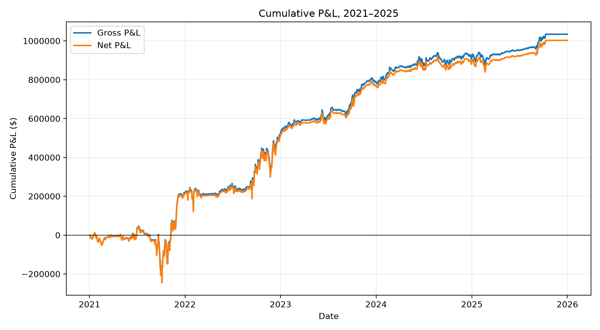

# Assignment 10 — Questions 1 and 2

## Question 1. Strategy

### (a) Rule

#### Part 1 — Trading theory and spread selection

Calendar spreads isolate seasonal relative-value effects while reducing the
outright price exposure common to both months. Before examining 2021–2025, I
chose 43 same-series candidates tied to natural-gas storage; energy refining,
heating and driving seasons; grain/soy crop transitions; or livestock/dairy
production cycles. Both legs are liquid months, year offset is at most one,
and the five R1 exclusions are omitted.

Using only trades exited by 31 December 2020, I tested entries 30, 60 and 120
business days before front LTD and exit at LTD minus two, separately in
contango and backwardation. Direction is the sign of training average gross
P&L. The screen required 12 total/eight same-regime observations, positive mean
and median net P&L, 60% hit rate, 1.5 t-statistic, early/late and neighboring-
exit stability, and positive mean with doubled costs and without the best
trade. `HE[V][Z0]` is a labelled pre-specified HW2 comparator (training t-stat
1.17). The 19 locked rules are:

| Spread    | Entry regime   |   Entry (business days to LTD) | Direction    | Selection      |   Exit (business days to LTD) |
|:----------|:---------------|-------------------------------:|:-------------|:---------------|------------------------------:|
| KE[H][N0] | backwardation  |                            120 | Short spread | Screen         |                             2 |
| ZC[U][Z0] | contango       |                            120 | Short spread | Screen         |                             2 |
| GF[Q][X0] | contango       |                             60 | Long spread  | Screen         |                             2 |
| KE[K][N0] | backwardation  |                            120 | Short spread | Screen         |                             2 |
| RB[J][M0] | contango       |                             30 | Long spread  | Screen         |                             2 |
| ZL[N][Z0] | contango       |                            120 | Short spread | Screen         |                             2 |
| HE[N][Q0] | backwardation  |                             30 | Long spread  | Screen         |                             2 |
| HO[U][F0] | contango       |                             30 | Long spread  | Screen         |                             2 |
| GF[U][X0] | backwardation  |                             30 | Long spread  | Screen         |                             2 |
| CL[H][M0] | contango       |                            120 | Short spread | Screen         |                             2 |
| HE[M][N0] | backwardation  |                            120 | Short spread | Screen         |                             2 |
| NG[J][X0] | contango       |                             60 | Short spread | Screen         |                             2 |
| ZW[K][N0] | contango       |                             60 | Short spread | Screen         |                             2 |
| NG[H][J0] | backwardation  |                            120 | Short spread | Screen         |                             2 |
| G[V][H0]  | contango       |                            120 | Long spread  | Screen         |                             2 |
| LE[M][V0] | contango       |                             30 | Long spread  | Screen         |                             2 |
| HO[V][H0] | contango       |                             60 | Long spread  | Screen         |                             2 |
| ZC[N][Z0] | contango       |                            120 | Short spread | Screen         |                             2 |
| HE[V][Z0] | backwardation  |                             30 | Long spread  | HW2 comparator |                             2 |

#### Part 2 — Trade implementation, position size, and solvency controls

On the settlement immediately before entry, I recompute business days to LTD
from `ltd` and trade only when the observed curve regime matches the table.
Entry is the next settlement; direction, lots and the LTD-minus-two exit date
are fixed, with no stops, early exits, compounding or resizing. Calculations use
only same-spread/same-regime instances exited before the decision. Fills use
settlements; each leg costs 2.5 bp of absolute notional at entry and exit.

Let `sigma` be the median daily dollar P&L volatility of one lot across those
completed instances. The risk size is
`q_risk = ($10m × 8% / sqrt(252) / sqrt(8)) / sigma`, so one new trade receives
about $17,817 of daily volatility before caps. At decision prices, one spread
lot has two-leg notional `n = P × (abs(S1) + abs(S2))`. Final lots equal the
minimum of `q_risk` and every remaining cap, rounded down to 0.01 lot. Caps are
20% of capital per trade, 25% per ticker, 40% per economic group and 150% total
gross, with at most ten trades and two per group. Simultaneous signals use the
higher training score first. I conservatively proxy margin as 15% of gross
notional and cap it at 25% of capital. The limits cannot eliminate gap risk,
but prevent reliance on unlimited leverage or unquantified margin.

### (b) Trades chosen in 2021

The historical average below is the average net P&L per one-lot spread among
same-regime instances completed before that trade's decision date.

| Spread    | Direction    | Entry      | Exit       |   Lots |   Past instances | Past average net P&L (one lot)   |
|:----------|:-------------|:-----------|:-----------|-------:|-----------------:|:---------------------------------|
| NG[J][X0] | Short spread | 2021-01-04 | 2021-03-25 |  37.49 |               20 | $1,927                           |
| LE[M][V0] | Long spread  | 2021-04-26 | 2021-06-03 |  21.02 |               16 | $407                             |
| GF[Q][X0] | Long spread  | 2021-06-03 | 2021-08-24 |  12.9  |               12 | $1,300                           |
| HE[N][Q0] | Long spread  | 2021-06-03 | 2021-07-13 |  21.25 |               13 | $1,145                           |
| HE[V][Z0] | Long spread  | 2021-09-02 | 2021-10-12 |  28.96 |               15 | $466                             |
| NG[H][J0] | Short spread | 2021-09-09 | 2022-02-22 |  23.89 |               20 | $3,740                           |
| KE[H][N0] | Short spread | 2021-09-13 | 2022-02-24 |  28.97 |                9 | $1,930                           |
| KE[K][N0] | Short spread | 2021-11-12 | 2022-04-27 |   6.08 |                9 | $1,038                           |

## Question 2. Performance, 2021–2025

### (a) Performance table

Returns and volatility are annualized from daily, non-compounded returns using
252 trading days. Drawdown includes zero as the initial peak for each row.
Annual P&L is assigned to the calendar day on which it occurred. “Trades” and
“Won” are classified by entry year; “Won” uses positive gross whole-trade P&L.
Cost/gross uses costs and gross P&L charged in the displayed calendar period.

| Period    | Gross Return   | Gross Vol   |   Gross Sharpe | Gross Max DD   | Net Return   | Net Vol   |   Net Sharpe | Net Max DD   |   Trades | Won     | Cost/gross   |
|:----------|:---------------|:------------|---------------:|:---------------|:-------------|:----------|-------------:|:-------------|---------:|:--------|:-------------|
| 2021      | 2.17%          | 2.90%       |           0.75 | -2.87%         | 2.11%        | 2.90%     |         0.73 | -2.89%       |        8 | 50.00%  | 2.82%        |
| 2022      | 3.00%          | 2.39%       |           1.26 | -1.36%         | 2.93%        | 2.39%     |         1.23 | -1.36%       |        8 | 62.50%  | 2.29%        |
| 2023      | 2.74%          | 1.04%       |           2.62 | -0.56%         | 2.68%        | 1.04%     |         2.57 | -0.56%       |        7 | 71.43%  | 2.23%        |
| 2024      | 1.28%          | 0.97%       |           1.33 | -0.63%         | 1.21%        | 0.97%     |         1.24 | -0.65%       |       10 | 70.00%  | 5.98%        |
| 2025      | 1.17%          | 0.85%       |           1.37 | -0.74%         | 1.12%        | 0.85%     |         1.32 | -0.74%       |        5 | 100.00% | 4.18%        |
| 2021–2025 | 2.07%          | 1.83%       |           1.13 | -2.87%         | 2.01%        | 1.83%     |         1.09 | -2.89%       |       38 | 68.42%  | 3.06%        |

### (b) Cumulative gross and net P&L

